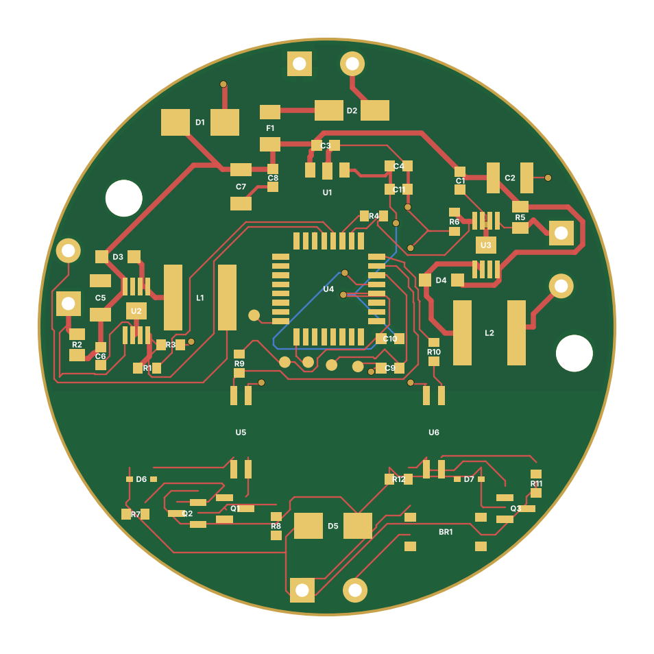
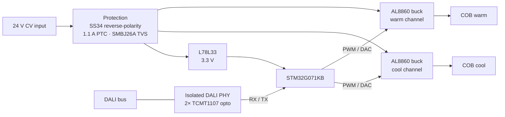

# TW DALI LED Module: Two-Channel Tunable-White Driver with Isolated DALI Interface

A Ø50 mm round control-and-driver module for tunable-white (TW) COB LEDs. It takes a 24 V constant-voltage supply, drives a warm and a cool LED channel with independent constant-current buck regulators, and is controlled over an optically isolated DALI bus by an STM32G0 microcontroller.

Personal hardware project, designed end to end in KiCad 9.

**Status:** schematic and 2-layer layout complete. Next steps are fabrication, bring-up and the DALI DT8 firmware.

  

---

## Architecture

The board is split into two galvanically isolated domains: the 24 V power and MCU domain, and the DALI bus domain. The only link between them is the two optocouplers (3.75 kV rms).

## Design Blocks

### Power input
- **Reverse-polarity protection:** SS34 Schottky in series.
- **Overcurrent:** 1.1 A resettable PTC fuse.
- **Transient clamp:** SMBJ26A TVS across the 24 V rail.
- **Logic supply:** L78L33 linear regulator for the MCU only, so its dissipation stays small (≈ 20.7 V × ~10 mA ≈ 0.2 W).

### Constant-current LED channels (×2, one hierarchical sheet instantiated twice)
- **Topology:** AL8860 hysteretic buck with high-side current sensing, a 47 µH Bourns SRN6028 inductor and a PMEG4010 freewheel Schottky.
- **Output current:** set by the sense resistor, I_LED = V_SENSE / R_S = 0.1 V / 0.15 Ω ≈ **667 mA** per channel (nominal), with P_RS ≈ 67 mW.
- **Dimming:** the CTRL pin accepts either timer PWM directly, or an analog level from the MCU DAC through 1 kΩ. Firmware keeps whichever source is unused in high impedance. A 10 kΩ pull-down holds the LEDs off while the MCU is in reset.
- **Decoupling:** 4.7 µF + 100 nF / 50 V at each regulator input.

### Isolated DALI physical layer
- **Polarity-free bus connection:** MB6S bridge rectifier, with an SMBJ24A TVS across the bus.
- **Receive:** a BZX384-C5V1 Zener sets the detection threshold between DALI low (< 4.5 V) and high (> 9.5 V). The opto LED current is limited by a two-transistor current sink (BC847 pair, R = 680 Ω), so I ≈ V_BE / R ≈ 1 mA, inside the DALI 2 mA per-device budget. The receiver output is pulled up to 3.3 V, so the logic is inverted (bus idle-high gives RX low).
- **Transmit:** the MCU drives the TCMT1107 LED through 330 Ω (≈ 6 mA). The opto output pulls the gate of an AO3400A to the bus through 10 kΩ, and the MOSFET shorts the rectified bus to signal a logic low. A 10 V Zener clamps V_GS, and 100 kΩ keeps the gate off by default.

### Microcontroller
| Function | STM32G071KB pin |
|---|---|
| DALI RX / TX | PA0 / PA1 |
| PWM cool / warm | PA6 (TIM3_CH1) / PA3 (TIM2_CH4) |
| DAC cool / warm | PA5 (DAC1_OUT2) / PA4 (DAC1_OUT1) |
| Programming | SWD test pads: 3V3, SWDIO, SWCLK, NRST, GND |

## PCB

- Round Ø50 mm, 2 layers, 1.6 mm FR-4, two M3 mounting holes.
- An isolation barrier: a ~5 mm copper keep-out band across the board under the two optocouplers separates the 24 V/MCU domain from the DALI domain. The bottom-layer ground pour stays on the power side only.
- Wide traces (0.8 mm `Power` net class) for the 24 V rail and the LED current loops. The buck switching loops are kept tight around each AL8860, its inductor and its freewheel diode.
- Solder-wire pads for 24 V in, DALI, and the two COB channels.

## Repository Contents

| Path | Contents |
|---|---|
| [`hardware/`](hardware) | KiCad 9 project: root sheet plus `power`, `led_channel` (×2), `mcu` and `dali` sub-sheets, and the PCB |
| [`docs/BOM.csv`](docs/BOM.csv) | Bill of materials (47 parts, 31 lines) |
| [`docs/pcb_top.png`](docs/pcb_top.png) | Layout render |

Open `hardware/TW_DALI_Module.kicad_pro` in KiCad 9 or later.

## Roadmap

- [ ] Fabricate and assemble the first batch
- [ ] Bring-up: verify 3.3 V rail, set-current accuracy, buck ripple and switching frequency at 24 V
- [ ] DALI PHY: verify RX threshold and TX timing (1200 bit/s Manchester) with a DALI master
- [ ] Firmware: IEC 62386-102 control gear plus DT8 colour-temperature commands
- [ ] Thermal measurement at full load on both channels

## License

[CERN Open Hardware Licence v2 – Strongly Reciprocal](LICENSE)
